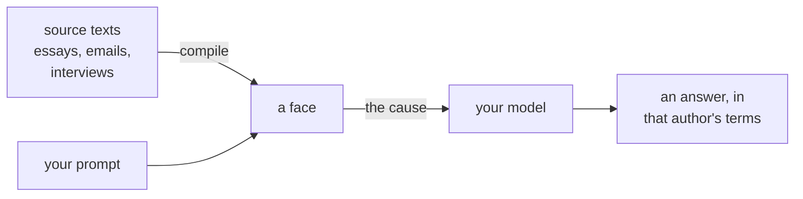

Large language models are general by design. They answer as no one in particular, and over a
long session they drift: the taste and judgement you wanted from them are whatever the prompt
managed to hold onto.

Faces are **causal models**. A face distills the essence of a particular author from
unstructured source texts, such as essays, blog posts, emails or interviews. When prompted, the
face returns a **cause**: the principal *why* that would motivate that author's response in the
given context. Causes are engineered to steer other AIs, so your agents keep a consistent,
bespoke point of view however long they run. They become *someone* instead of no one.

## Causes, not reasons

Causes are upstream of reasons. A reason is what you tell a police officer when they ask why
you didn't stop at a red light; a cause is how you determined what to say.

## The APIs

| API | Endpoint | Returns |
| - | - | - |
| [Choices](/guides/choices) | `/v1/choices` | the options the face would weigh, strongest first, or the question it would ask |
| [Decisions](/guides/decisions) | `/v1/decisions`, `/v1/systemone` | typed `answers`, with a `cause` per question |
| [Causes](/guides/causes) | `/v1/causes` | the `cause` alone |

[Choices](/guides/choices) is the way to run a face: describe a situation, in prose or as a
[state](/guides/states) your agent keeps, and ask a question. Choices are
[billed](/guides/billing) on the tokens each call processes; causes and decisions per input
token. [Chat is retired](/guides/chat).

## Compiled, not trained

A face is compiled from unstructured text. There is no dataset to prepare and no
training run, and a face is not tied to any one base model. Add a source and recompile; remove
one and what it contributed goes with it.

Compiled faces are **composable** and **comparable**. Combine faces with boolean algebra
(`alice | bob`, `alice & bob`, `alice - bob`) into [synthetic faces](/guides/synthetic-faces),
and [measure how alike](/concepts/centroids) any two faces are.

## Next steps

* [Quickstart](/quickstart): an API key, a face, and its first choices in a few minutes.
* [Faces](/guides/faces): create and manage faces.
* [Compile](/guides/compile): turn source texts into a face.
* [Choices](/guides/choices): ask a face what it would do.
* [States](/guides/states): keep the situation your agent builds.
* [Decisions](/guides/decisions): typed answers from a face.
