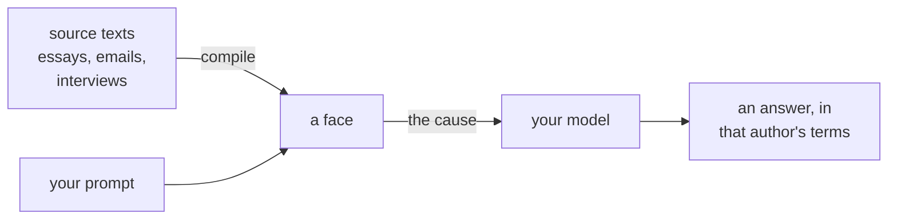

Large language models are general by design. They answer as no one in particular, and over a
long session they drift: the taste and judgement you wanted from them are whatever the prompt
managed to hold onto.

Faces are **causal models**. A face distills the essence of a particular author from
unstructured source texts, such as essays, blog posts, emails or interviews. When prompted, the
face returns a **cause**: the principal *why* that would motivate that author's response in the
given context. Causes are engineered to steer other AIs, so your agents keep a consistent,
bespoke point of view however long they run. They become *someone* instead of no one.

## Causes, not reasons

Causes are upstream of reasons. A reason is what you tell a police officer when they ask why
you didn't stop at a red light; a cause is how you determined what to say.

## The Causes API and its wrappers

Call the [Causes API](/guides/causes) for the cause alone. Or call a wrapper: a drop-in
replacement for an API you already use, which takes `face@model` and returns that model's
answer, steered by the face's cause, in a single request.

| API | Endpoints | Compatible with | Returns |
| - | - | - | - |
| [Causes](/guides/causes) | `/v1/causes` | | the `cause` |
| [Chat](/guides/chat) | `/v1/chat/completions`, `/v1/responses`, `/v1/messages` | OpenAI, Anthropic | the model's answer, with its `cause` |
| [Decisions](/guides/decisions) | `/v1/decisions`, `/v1/systemone` | OpenAI, TypeSafe | typed `answers`, with a `cause` per question |

A wrapped call is [billed](/guides/billing) for the cause and for the model, at the provider's
price plus 5%. Compiling and causes are billed per input token; output is free.

### What a wrapper sends the model

A wrapper sends the answering model more than the cause: the face's name and the identity
details relevant to the request. On the chat wrappers, a request with
[`style`](/guides/style#3-use-it) also sends the face's built style for that medium (email,
text message, essay and so on), so the reply reads the way the face would write it there.
Style applies only on the chat wrappers.

### Chat and decisions can differ

The same face can make different choices on similar prompts through the two wrappers. Chat is
open-ended: the model writes its own answer. A decision is closed-ended: the model picks among
the options or levels you give, and returns typed answers. A style, which only chat uses, can
also shift a reply.

## Compiled, not trained

A face is compiled from unstructured text. There is no dataset to prepare and no
training run, and a face is not tied to any one base model. Add a source and recompile; remove
one and what it contributed goes with it.

Compiled faces are **composable** and **comparable**. Combine faces with boolean algebra
(`alice | bob`, `alice & bob`, `alice - bob`) into [synthetic faces](/guides/synthetic-faces),
and [measure how alike](/concepts/centroids) any two faces are.

## Next steps

* [Quickstart](/quickstart): an API key, a face, and its first cause in a few minutes.
* [Faces](/guides/faces): create and manage faces.
* [Compile](/guides/compile): turn source texts into a face.
* [Chat](/guides/chat): answer as a face on any supported model.
* [Decisions](/guides/decisions): typed answers from a face.
